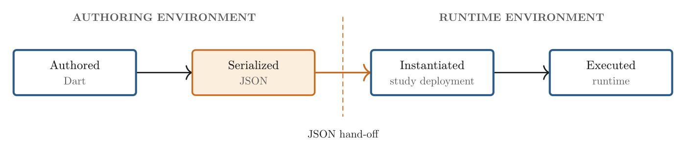
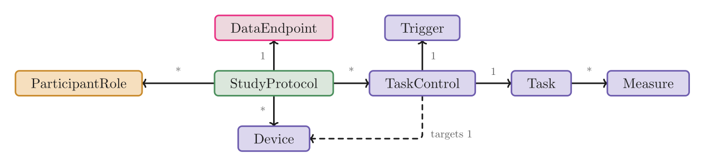
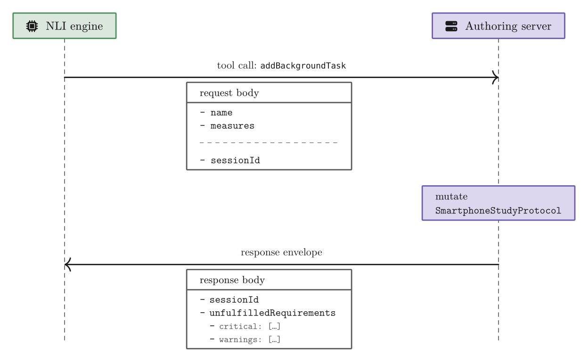

# CAMS Protocol Authoring Server

Stateful HTTP API for building [CARP Mobile Sensing](https://github.com/cph-cachet/carp.sensing-flutter) (CAMS) study protocols one request at a time.

A client opens a session, sends a sequence of typed authoring calls (add device, add trigger, add task, …) and exports the finalised JSON when the session is complete. The server validates every mutation against the CAMS domain model and reports unfulfilled requirements back to the client after each call, so an interactive client can author and self-correct in the same loop.



This repo covers the **authoring environment** half of the diagram. The serialised JSON is the hand-off: it is the artefact consumed by the CAMS runtime to deploy and execute the study.

## What you build

Each session materialises a `SmartphoneStudyProtocol` composed of participant roles, devices, data endpoints, task controls, triggers, tasks and measures. The endpoints map onto this domain model:



| Capability                           | Route modules                                                                               |
| ------------------------------------ | ------------------------------------------------------------------------------------------- |
| Session and core protocol lifecycle  | `authoring_routes/core.dart`                                                                |
| Participant roles and expected data  | `authoring_routes/participant_role.dart`, `authoring_routes/participant_expected_data.dart` |
| Primary and additional devices       | `authoring_routes/primary_device.dart`, `authoring_routes/devices.dart`                     |
| Tasks and task controls              | `authoring_routes/tasks.dart`, `authoring_routes/task_controls.dart`                        |
| Triggers                             | `authoring_routes/triggers.dart`                                                            |
| Services and data endpoints          | `authoring_routes/services.dart`, `authoring_routes/data_endpoint.dart`                     |

## Typed authoring loop

Every authoring call is a typed, idempotent operation. The request carries the operation's own fields plus a `sessionId`; the response carries the updated `sessionId` and an `unfulfilledRequirements` list (`critical` + `warnings`) so the client knows what still needs to be done before the protocol is valid.



This loop is what makes the server a good target for programmatic authoring. The [NLI engine](https://github.com/Congiuntivo/cams-nli-engine) is the primary client: it drives an LLM through this same sequence of typed calls to compose protocols from natural-language descriptions.

## Related repos

- [**cams-nli-engine**](https://github.com/Congiuntivo/cams-nli-engine): LLM-based natural-language interface that drives this server to generate protocols from plain English.
- [**cams-kb**](https://github.com/Congiuntivo/cams-kb): ingestion and retrieval pipeline over the CAMS documentation; feeds the NLI engine's RAG step.

## Run locally

### Prerequisites (Fedora)

```bash
sudo dnf install -y \
    cmake ninja-build pkg-config \
    gtk3-devel \
    clang libsecret-devel webkit2gtk4.1-devel \
    gstreamer1-devel gstreamer1-plugins-base-devel
```

### Start

```bash
flutter pub get
flutter run -d linux
```

The API server listens on `http://0.0.0.0:8080`.

Environment variables:

1. `HOST` (default: `0.0.0.0`)
2. `PORT` (default: `8080`)

## Run with Docker

Build the image locally and tag it for GitHub Container Registry:

```bash
docker build -t ghcr.io/congiuntivo/cams-authoring-server:latest .
docker push ghcr.io/congiuntivo/cams-authoring-server:latest     # requires auth
```

Pull and run:

```bash
# Default port, auto-removed on exit
docker run --rm -it -p 8080:8080 \
    ghcr.io/congiuntivo/cams-authoring-server:latest

# Custom port
docker run -e PORT=9090 -p 9090:9090 \
    ghcr.io/congiuntivo/cams-authoring-server:latest

# Persistent named container
docker run -d --name cams-authoring-server -p 8080:8080 \
    ghcr.io/congiuntivo/cams-authoring-server:latest
```

Notes:

1. The container runs the headless entrypoint (`lib/main.dart`) on the Linux Flutter runner under a virtual X server. No host UI window is shown.
2. Session state is in-memory and resets when the container stops.
3. If port `8080` is already in use, remap with `-p <hostPort>:8080` and set `PORT=8080` in the container, or change both host and container ports consistently.
4. The startup command clears stale Xvfb display lock files, so a previously stopped container can be started again with `docker start`.

## API docs

1. OpenAPI JSON: `http://localhost:8080/openapi.json`
2. OpenAPI YAML: `http://localhost:8080/openapi.yaml`
3. Swagger UI: `http://localhost:8080/docs`

## Architecture

```text
.
├── lib
│   ├── openapi_spec_builder.dart
│   └── src
│       ├── authoring_request_handler.dart
│       ├── authoring_session_store.dart
│       ├── authoring_service/
│       │   ├── utils/task_measure_parser.dart
│       │   ├── authoring_service.dart
│       │   └── *.dart (devices, services, tasks, triggers)
│       ├── authoring_session/
│       │   ├── utils/ (authoring_requirements, authoring_session_state, in_memory_authoring_session_state)
│       │   ├── authoring_session.dart
│       │   └── *.dart (devices, participants, primary_device, services, task_controls, tasks, triggers)
│       ├── http/
│       │   ├── dto/
│       │   │   ├── request_bodies/ (core, device, duration, service, task_control, task, trigger)
│       │   │   └── request_parsing_utils.dart
│       │   ├── handlers/
│       │   │   ├── authoring_routes/ (core, data_endpoint, devices, participant_*, primary_device, services, task_controls, tasks, triggers)
│       │   │   ├── authoring_routes.dart
│       │   │   └── docs_routes.dart
│       │   └── response/json_response.dart
│       └── openapi/
│           ├── openapi_annotations.dart
│           └── openapi.dart
├── openapi/
│   └── openapi.yaml
└── test/
    ├── protocol_authoring_endpoints/   (HTTP endpoint tests, domain-split)
    ├── protocol_authoring_service/     (service-layer unit tests, domain-split)
    └── *.dart (error handling, contract, serialization, deployment, parsing)
```

### Layers

1. `authoring_session/*.dart`: domain state and protocol mutation rules.
2. `authoring_session/utils/authoring_requirements.dart` + `authoring_service/utils/task_measure_parser.dart`: cross-cutting validation and measure parsing.
3. `authoring_service/*.dart`: application and use-case orchestration.
4. `authoring_request_handler.dart`: Shelf middleware pipeline and route composition root.
5. `http/handlers/authoring_routes/*.dart`: endpoint handlers and OpenAPI metadata.
6. `http/dto/**/*.dart`: request DTOs and parsing helpers.
7. `http/response/json_response.dart`: shared JSON response formatting.

### Request pipeline

1. Request logging.
2. Error mapping: `FormatException → 400`, `AuthoringRequirementsException → 409`, any other error → 500.
3. Route handling with explicit 404 fallback.

## Testing

```bash
flutter test
```

Test suites cover session behaviour, service logic, endpoint contracts, error handling, request parsing, serialisation and deployment payloads.

## OpenAPI generation

Code-first workflow:

1. Route handlers annotate docs via `@ApiController`, `@ApiOperation` and `@ApiSchemas` in `lib/src/http/handlers/authoring_routes/*.dart`. `@ApiSchemas` on each mixin class declares the request and response schemas for that route domain; `@ApiController` on `AuthoringRoutes` declares cross-cutting schemas.
2. `lib/openapi_spec_builder.dart` generates `openapi/openapi.yaml`.
3. `openapi_generator` builds the client in `lib/src/generated/openapi/`.

Regenerate spec and client:

```bash
dart run build_runner build --delete-conflicting-outputs
```

## Persistence model

Both storage boundaries follow the same abstract-interface + in-memory-implementation pattern:

| Abstraction             | In-memory impl                  | Owns                                                  |
| ----------------------- | ------------------------------- | ----------------------------------------------------- |
| `AuthoringSessionStore` | `InMemoryAuthoringSessionStore` | the `Map<sessionId, AuthoringSession>` registry       |
| `AuthoringSessionState` | `InMemoryAuthoringSessionState` | protocol, devices, tasks, triggers within one session |

`AuthoringSession` accepts an optional `AuthoringSessionState` via its constructor. The default is the in-memory implementation; a persistence-backed implementation can be injected without touching any business logic.

## Maturity and limits

1. Current storage is in-memory; state is lost on restart.
2. Intended for local development and validation workflows.

## MCP sidecar

`mcp_server/` contains a Python ([uv](https://docs.astral.sh/uv/)-managed) [FastMCP](https://gofastmcp.com) sidecar that exposes this server's API as MCP tools by loading `openapi/openapi.yaml` directly. Start the Dart server first, then in another terminal:

```bash
cd mcp_server
uv sync
uv run carp-mcp
```

See `mcp_server/README.md` for transport options and configuration.

## License

MIT. See [LICENSE](LICENSE).
